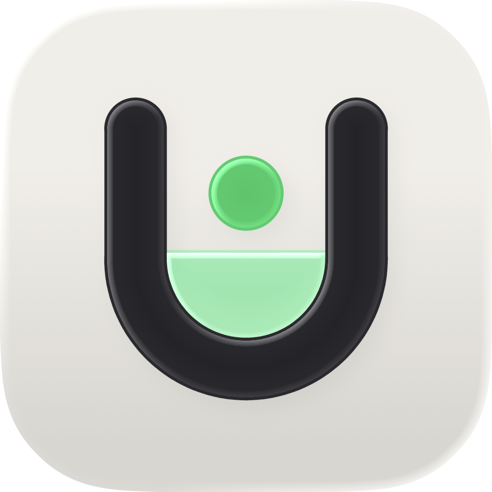

<p align="center">
  
</p>

<h1 align="center">Umapp</h1>

<p align="center">
  <strong>English</strong> |
  <a href="README.zh-CN.md">简体中文</a>
</p>

<p align="center">
  <a href="https://github.com/oneo-me"></a>
  <a href="https://oneo.me"></a>
  <a href="https://x.com/oneo666"></a>
  <a href="https://github.com/sponsors/oneo-me"></a>
</p>

<p align="center">
  A native menu bar app that shows the websites of an <a href="https://umami.is">Umami</a> account and their visitors. It is built with <a href="https://github.com/oneo-me/nsgo">NSGo</a>, in Onevra's look.
</p>

## Features

- Open a panel from the menu bar with every website the API key can see, and how many people are on them now.
- Show visitors and a sparkline for 24 hours, 7 days, 30 days or 90 days, compared with the range before.
- Open one website for bounce rate, duration, a chart with counts under the pointer, and the top pages, referrers and countries with their icons and flags.
- Connect to Umami Cloud or a server of your own, hide websites, and sort them by visitors or name.
- Show the count of visitors online beside the icon, or hide it.
- Open at login on macOS.

## Install

No release is published yet. Build from source with the [Development](#development) commands.

Requirements:

- Go 1.27 or later.
- macOS, Windows, or Linux (a desktop session is needed to run the app).

## Getting started

1. Start Umapp. It adds an icon to the menu bar.
2. Open the panel and set the API endpoint (Umami Cloud by default) and an API key from *Settings → API keys*.
3. Browse the websites, change the range, or open one for its breakdown.
4. Right-click the icon to quit.

On macOS the key is kept in the login keychain; elsewhere it is stored in the app's user data directory.

## Development

The Go module and the packaging configuration, `nsgo.yaml`, live in `source/`. NSGo comes from a checkout beside this repository's, which `source/go.mod` replaces it with. Run Go and NSGo commands from `source/`:

```sh
cd source
go tool nsgo dev
go tool nsgo build
GOWORK=off go test ./...
```

See [ARCHITECTURE.md](ARCHITECTURE.md) for the layout and [AGENTS.md](AGENTS.md) for the working rules.

See [CHANGELOG.md](CHANGELOG.md) for what changed.

## License

Licensed under the [MIT License](LICENSE).
