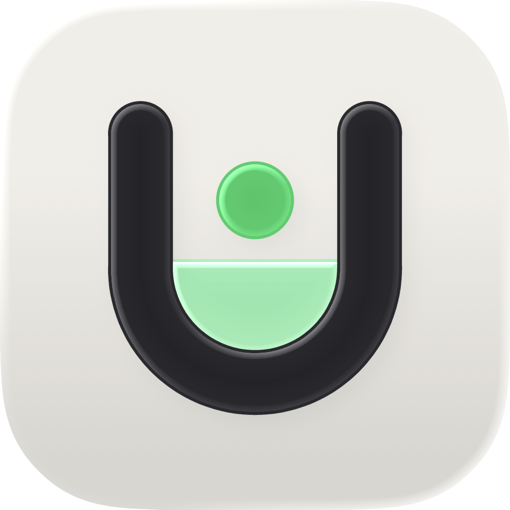

<p align="center">
  
</p>

<h1 align="center">Umapp</h1>

<p align="center">
  <a href="README.md">English</a> |
  <strong>简体中文</strong>
</p>

<p align="center">
  <a href="https://github.com/oneo-me"></a>
  <a href="https://oneo.me"></a>
  <a href="https://x.com/oneo666"></a>
  <a href="https://github.com/sponsors/oneo-me"></a>
</p>

<p align="center">
  一个原生菜单栏应用，显示 <a href="https://umami.is">Umami</a> 账户下的网站和访客。基于 <a href="https://github.com/oneo-me/nsgo">NSGo</a> 构建，采用 Onevra 的外观。
</p>

## 功能

- 从菜单栏打开面板，查看该 API 密钥能看到的每个网站，以及当前有多少人在浏览。
- 按 24 小时、7 天、30 天或 90 天显示访客/浏览和趋势，并与上一段对比。
- 打开单个网站，查看跳出率、访问时长、指针悬停显示数量的图表，以及带图标和国旗的热门页面、来源和国家/地区。
- 连接 Umami Cloud 或自建服务器，并按访客、浏览或名称为网站排序，每个网站都附上域名。
- 在图标旁显示在线访客数，也可以关掉。
- 开机时启动。

## 安装

还没有发布版本。请按[开发](#开发)一节从源码构建。

要求：

- Go 1.27 或更高版本。
- Apple 芯片的 macOS。

## 快速开始

1. 启动 Umapp。它会在菜单栏添加一个图标。
2. 打开面板，设置 API 地址（默认为 Umami Cloud）和在 *设置 → API 密钥* 中创建的密钥。
3. 浏览网站、切换时间范围，或打开某个网站查看明细。
4. 右键点击图标可以退出。

密钥保存在登录钥匙串中。

## 开发

Go 模块和打包配置 `nsgo.yaml` 位于 `source/`。NSGo 来自与本仓库并列的检出，由 `source/go.mod` 的 replace 指向。请在 `source/` 下运行 Go 和 NSGo 命令：

```sh
cd source
go tool nsgo dev
go tool nsgo build
GOWORK=off go test ./...
```

布局见 [ARCHITECTURE.md](ARCHITECTURE.md)，协作规则见 [AGENTS.md](AGENTS.md)。

变更见 [CHANGELOG.md](CHANGELOG.md)。

## 许可证

以 [MIT License](LICENSE) 授权。
